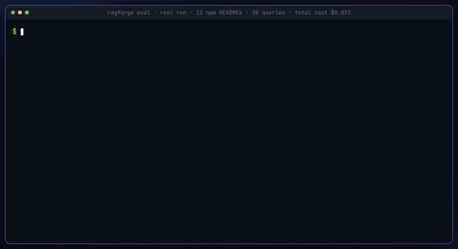

<div align="center">


<h3>Find the RAG setup that works on <em>your</em> data.<br>Then ship it.</h3>

AutoRAG for JavaScript: HyDE · Step-Back · Fan-Out · hybrid search · reranking · contextual retrieval<br>
benchmarked and tuned on your documents, routed per query, with cost tracking built in.

<br>

[](https://www.npmjs.com/package/ragforge)
[](https://github.com/Kamraanmulani/ragforge/actions/workflows/ci.yml)
[](./index.d.ts)
[](https://nodejs.org)
[](./LICENSE)

[Quick start](#quick-start) ·
[Eval](#benchmark-techniques-on-your-data) ·
[Tune](#tune-the-whole-setup) ·
[Index](#keep-an-index-up-to-date) ·
[Frameworks](#use-with-langchain-ai-sdk-llamaindex-and-mastra) ·
[Dashboard](#see-it-all-in-a-dashboard) ·
[Auto-routing](#auto-routing) ·
[Techniques](#techniques) ·
[API](#api-reference) ·
[Changelog](./CHANGELOG.md)

</div>

<br>

<div align="center">

<br>
<sub>A real run on 12 popular npm package READMEs (30 queries, gpt-4o-mini, total cost 3 cents). On these docs, plain search matched or beat every technique, and HyDE cost 350× more per query while finding the right chunk less often. Your data may say otherwise. That's why you measure.</sub>
</div>

<br>

## Why ragforge?

Query techniques like HyDE and Step-Back can lift retrieval a lot on some data, do nothing on other data, and every one of them costs extra LLM calls. Most libraries hand you the techniques and leave you guessing.

ragforge answers the question first:

- **📊 Measure.** `npx ragforge eval` builds a test set from your documents and scores every technique on hit rate, MRR, latency and cost. It recommends plain search when the techniques don't earn their cost.
- **🧭 Route.** `rf.auto(query)` picks a technique per query, from the eval's per-category winners or from built-in rules, so simple lookups stay cheap.
- **🔌 Plug in anything.** OpenAI or a local Ollama model (free), any vector database, any custom provider. Stats, caching and TypeScript types included.

## Installation

```bash
npm install ragforge
```

Requires Node.js 18+, and an `OPENAI_API_KEY` (in your environment or a `.env` file in your project root) or a running [Ollama](https://ollama.com) server.

## Quick start

**1. Find out what works on your documents.** No database needed; this indexes them in memory.

```bash
npx ragforge eval --docs ./docs --json eval.json
```

**2. Use the winner in your app, per query.**

```js
const { createRagforge } = require('ragforge');

const rf = createRagforge({ vectorStore: myVectorStore });

const result = await rf.auto('How do refunds work for annual plans?', {
  from: require('./eval.json'),
});

console.log(result.answer);        // "Annual plans are refunded pro rata [1] ..."
console.log(result.sources);       // [{ ref: 1, id, content, score, metadata, cited: true }, ...]
console.log(result.route.reason); // why this technique was chosen
console.log(result.stats);        // { llmCalls, inputTokens, outputTokens, costUSD, latencyMs, ... }
```

**Or call a technique directly:**

```js
const { hyde, stepback } = require('ragforge');

const answer = await hyde('What are the benefits of vector databases?');
const { abstractQuery } = await stepback("Why did my Postgres query stop using the index?");
```

<details>
<summary><b>Free and local with Ollama</b></summary>

```bash
ollama pull llama3.1 && ollama pull nomic-embed-text
npx ragforge eval --docs ./docs --provider ollama
```

```js
const rf = createRagforge({ llm: 'ollama' });
```

</details>

## Benchmark techniques on your data

```bash
npx ragforge eval --docs ./docs
```

1. **Index.** Reads `.txt`, `.md`, `.mdx`, `.rst`, `.html`, `.pdf` and `.docx` files and web pages, splits them into chunks and embeds them into an in-memory store.
2. **Generate questions.** The LLM writes a test query for chunks spread across your documents, mixing three styles real users have: full questions, short keyword searches and vague *why/how* questions. The chunk it came from is the right answer. Queries that only make sense next to the passage ("the function described…") are thrown out and replaced.
3. **Run.** Every technique runs on every question, and ragforge checks whether it retrieved that chunk in the top *k*.
4. **Score and recommend.** You get hit@k, MRR, latency, cost per query and LLM calls for each technique. A technique that adds LLM calls has to beat plain search by **5 points** to be recommended. Hybrid search adds none, so it only has to rank higher.

| Option | Default | |
|---|---|---|
| `--docs <path\|url>` | | File, folder or http(s) URL, repeatable. See [Documents](#documents) |
| `--questions <n>` | `10` | Questions to generate |
| `--questions-file <file>` | | Your own: `[{ "question": "...", "expectedText": "..." }]`, or an earlier `--json` result |
| `--from-logs <file>` | | Real queries from a JSONL trace log, labelled with `ragforge label`. See [real user queries](#evaluate-on-real-user-queries) |
| `--labels <file>` | `ragforge-labels.json` | Labels file for `--from-logs` |
| `--question-styles <list>` | `question,keywords,conceptual` | Which generated query styles to mix |
| `--techniques <list>` | `baseline,hybrid,hyde,stepback,fanout` | Also `cot`; combine with `+`, e.g. `hybrid+hyde` |
| `--provider <name>` | `openai` | `openai` or `ollama` |
| `--embeddings <name>` | same as provider | Mix providers |
| `--model <name>` | provider default | Chat model |
| `--embedding-model <name>` | provider default | Embedding model |
| `--reranker <name>` | | `llm`, `cohere` or `jina`; adds `rerank` and `hybrid+rerank` to the techniques |
| `--rerank-candidates <n>` | `20` | Candidates retrieved before reranking |
| `--answers` | | Also grade answer quality with an LLM judge. See [Answer quality](#answer-quality) |
| `--judge-model <name>` | same as `--model` | Chat model that grades the answers |
| `--top-k <n>` | `5` | Results per search |
| `--chunk-size <n>` | `800` | Max characters per chunk |
| `--chunk-strategy <name>` | `paragraph` | How documents are split. See [Chunking](#chunking) |
| `--chunk-overlap <n>` | `0` | Characters repeated between chunks (`fixed` and `sentence`) |
| `--contextual` | | Also score contextual retrieval. See [Contextual retrieval](#contextual-retrieval) |
| `--context-model <name>` | same as `--model` | Chat model that writes the context lines |
| `--context-budget <usd>` | | Stop before writing context lines that would cost more |
| `--context-cache <file>` | `.ragforge/context-cache.json` | Where context lines are kept between runs; `none` turns it off |
| `--concurrency <n>` | `4` | Parallel requests |
| `--html <file>` | | Shareable report, works in light and dark mode |
| `--json <file>` | | Full results, usable with `auto({ from })` |
| `--markdown <file>` | | Scoreboard as Markdown, for pull request comments |
| `--compare <file>` | | Earlier `--json` result to compare against. See [CI](#catch-retrieval-regressions-in-ci) |
| `--fail-on-drop <points>` | | With `--compare`: exit 1 when hit@k fell by more than this many points |

With OpenAI, a 10-question run on the default techniques makes about 40 small `gpt-4o-mini` calls plus embeddings. The scoreboard shows the exact cost.

### Chunking

How documents are cut into chunks often matters more than the query technique. Pick a strategy with `--chunk-strategy` (or `chunkStrategy` in `evaluate()`). Every strategy keeps chunks under `--chunk-size`.

| Strategy | Splits | Good for |
|---|---|---|
| `paragraph` (default) | Packs whole paragraphs; long ones are split at sentences | Most prose. Unchanged from earlier versions, so saved baselines still match |
| `fixed` | Windows of characters, cut at a word. `--chunk-overlap` repeats the end of each window | A simple reference point |
| `sentence` | Packs whole sentences and never cuts one. `--chunk-overlap` repeats the last sentences | Dense text with long paragraphs |
| `markdown-heading` | One section per chunk, starting with its heading trail, e.g. `Setup > Windows` | Docs sites and READMEs: a passage found on its own still says what it's about |
| `semantic` | Sentences, split where the topic shifts (embedding similarity drops) | Long pages without headings. Costs one embedding call per sentence, shown in the setup cost |
| `code` | Source files by top-level function, class or declaration, keeping comments and decorators with them. Other files by paragraph | Code search. Also reads `.js`, `.ts`, `.py`, `.go`, `.rs`, `.java` and other source files from `--docs` folders, skipping `dist`, `build` and `vendor` |

To see which works on your docs, save a run and replay its questions with another strategy:

```bash
npx ragforge eval --docs ./docs --json paragraph.json
npx ragforge eval --docs ./docs --questions-file paragraph.json --chunk-strategy markdown-heading --compare paragraph.json
```

Replayed questions look for their passage's opening words, not its chunk id, and heading marks and whitespace are ignored, so they score fairly across strategies. A passage whose opening words get cut across two chunks counts as a miss, which can happen with `fixed` and `semantic`. Overlap repeats text between chunks, so a fact can be found in two places. That's realistic, but it makes hit rates a little easier than with no overlap.

In code, `chunkText(text, { strategy, size, overlap })` splits one text and `chunkDocuments(documents, { strategy, size, overlap, embed })` splits many (semantic needs `embed`).

### Contextual retrieval

A chunk often doesn't name what it is about: *"They take five business days to arrive"* says nothing about refunds or your product. Contextual retrieval asks an LLM, once per chunk at index time, for a line that places the chunk in its document (*"From the Acme Cloud billing guide, the section on how long refunds take."*). The line is embedded and keyword-indexed with the chunk. Users and the answer still see the chunk as written. Anthropic [reported](https://www.anthropic.com/news/contextual-retrieval) this cut failed retrievals by 35% with embeddings alone and by 49% with keyword search added. On your docs it may help less, or not at all, so measure it:

```bash
npx ragforge eval --docs ./docs --contextual
```

`--contextual` adds two techniques to the scoreboard: `contextual` (vector search on the contextual index) and `contextual+hybrid` (with keyword search too). It combines with the others, e.g. `--techniques baseline,hybrid,contextual+hybrid,contextual+rerank`.

- **Cost up front.** Before any context line is written, ragforge prints the number of LLM calls and the estimated cost. Add `--context-budget 0.50` to stop there if it would cost more. `--context-model` picks a cheaper model for the lines.
- **Paid once.** The scoreboard reports the context lines as a one-time index cost, apart from cost per query, which doesn't change. Because the cost is real, contextual has to beat plain search by 5 points of hit@k to be recommended, like other techniques that add LLM calls.
- **Cached.** Lines are saved in `.ragforge/context-cache.json` and reused while the chunk, its document and the model stay the same, so later runs only pay for new or changed chunks. Long documents are cut to a 24,000-character window around each chunk.
- **Chat and MCP.** `npx ragforge chat --docs ./docs --contextual` and `npx ragforge mcp --docs ./docs --provider ollama --contextual` index with context lines too.

To use it in production, index your store with contextual chunks. Embed and keyword-index `indexText`, and store `content` for display:

```js
const { createRagforge, chunkDocuments, loadDocuments, createFileCache } = require('ragforge');

const rf = createRagforge();
const documents = await loadDocuments('./docs');
const chunks = await chunkDocuments(documents, { strategy: 'markdown-heading' });

console.log(await rf.estimateContextCost(chunks, documents)); // { calls, costUSD, ... }
const { chunks: contextual, stats } = await rf.contextualize(chunks, documents, {
  budgetUSD: 1,
  cache: createFileCache('.ragforge/context-cache.json'),
});

for (const c of contextual) {
  const vector = await rf.getEmbedding(c.indexText);
  await db.insert({ id: c.id, content: c.content, search_text: c.indexText, vector });
}
```

A chunk whose LLM call fails is indexed without context and counted in `failed`. `createMemoryVectorStore()` and `createBM25Index()` take `indexText` on each entry and search it, while results return `content`. When `auto({ from: eval })` picks a contextual technique, it searches your store as usual: contextual retrieval is a choice about how the store was built.

<details>
<summary><b>From code, or against your production vector store</b></summary>

```js
const fs = require('fs');
const { createRagforge, loadDocuments, formatTable, renderHtmlReport } = require('ragforge');
const rf = createRagforge();

const result = await rf.evaluate({
  documents: await loadDocuments(['./docs', 'handbook.pdf']), // or [{ id, content }]
  techniques: ['baseline', 'hybrid', 'hyde', 'stepback', 'hybrid+hyde'],
  numQuestions: 20,
});

console.log(formatTable(result));
fs.writeFileSync('report.html', renderHtmlReport(result));

// Test the store you already have, with your own questions
rf.setVectorStore(myQdrantStore);
await rf.evaluate({
  questions: [{ question: 'How long do refunds take?', expectedText: 'within 5 business days' }],
});
```

</details>

### Answer quality

Finding the right chunk doesn't guarantee a correct answer. Add `--answers` to grade the answers too:

```bash
npx ragforge eval --docs ./docs --answers
```

For every technique, ragforge writes an answer from the passages that technique retrieved, with the same prompt `ragPipeline` and `auto` use, and an LLM judge grades it. The scores sit next to the retrieval scores. This is a run on this README, with 10 questions and `--techniques baseline,hybrid,hyde`:

```
technique   hit@5   MRR     faithful   relevance   ctx recall   citations   latency   cost/query   LLM calls   errors
---------   -----   -----   --------   ---------   ----------   ---------   -------   ----------   ---------   ------
hybrid ★    100%    0.883   75% ±10    100%        100%         71% ±20     293ms     $0.000001    0
baseline    90%     0.708   61% ±19    100%        94% ±12      72% ±17     316ms     $0.000001    0
hyde        70%     0.583   68% ±14    100%        76% ±25      70% ±12     6.8s      $0.000326    1

Answers: 30 written and graded by gpt-4o-mini (judge v1), cost $0.0372. ± is the 95% interval across questions.
```

| Column | What it measures |
|---|---|
| `faithful` | Share of the answer's claims that the retrieved passages support. Low means the model made things up |
| `relevance` | Whether the answer addresses the question: fully, partly or not at all |
| `ctx recall` | Share of the facts needed for the answer that were retrieved. Unlike hit@k, it gives credit when another passage holds the answer |
| `citations` | Share of the answer's `[1]`-style citations that point at a passage supporting the statement. An answer with claims and no citations scores 0 |

- **Cost.** About 4 extra LLM calls per question and technique: one answer, and a judge call for each metric that needs one. Techniques that retrieved the same passages share one answer and one set of grades. Latency and cost per query in the table stay retrieval-only, and the answer cost is reported on its own line.
- **A judge that has to show its evidence.** For every claim, fact or citation it accepts, the judge must quote the passage, and ragforge checks that the quote is really there. A "yes" without a valid quote counts as a "no". Asked for a plain yes or no, judge models approve almost everything.
- **See what went wrong.** In the `--json` result, each question's run has `findings`: the `unsupportedClaims`, `missingFacts` and `wrongCitations` behind a low score.
- **Judge noise.** The judge runs at temperature 0 with fixed, versioned prompts, and `±` shows how far each mean could be off with this many questions. With 10 questions the intervals are wide, so use `--questions 30` or more before trusting small differences.
- **A stronger judge.** `--judge-model gpt-4o` grades with a different model than the one that writes the answers.
- **In CI.** With `--answers` on both runs, `--fail-on-drop` also fails on a faithfulness drop. Scores are only compared between runs graded by the same judge model and judge version.
- **Reference answers.** For your own questions, add `expectedAnswer` and context recall is judged against it when the expected chunk was missed.

From code: `rf.evaluate({ documents, answers: true, judgeOptions: { model: 'gpt-4o' } })`. Each row gets an `answers` object with the four scores and their intervals, and each question's runs keep the `answer` and its `scores`.

### Documents

| Format | How it's read | Needs |
|---|---|---|
| `.txt` `.md` `.mdx` `.markdown` `.rst` | As is | |
| `.html` `.htm` | Main content only (`<main>` or `<article>` when present). Scripts, styles, nav, header, footer and sidebars are dropped. Headings and list items are kept. | |
| `.pdf` | Text of every page | `npm install unpdf` (Node 22+) |
| `.docx` | Text of every paragraph | `npm install mammoth` |
| `https://...` | Fetched, then read by content type (HTML, PDF, DOCX or text) | |

PDF and DOCX support use optional packages, so ragforge stays small if you don't need them. You'll get an install hint the first time a file needs one. Scanned PDFs without a text layer are skipped, because there's no text to index.

```js
const { loadDocuments } = require('ragforge');

const docs = await loadDocuments(['./docs', 'contracts/terms.pdf', 'https://example.com/faq']);
// [{ id: 'docs/intro.md', content: '...', metadata: { source, type } }, ...]
```

Folders are read recursively, skipping hidden files and `node_modules`. File ids are relative paths (`docs/guides/faq.html`), and URL ids are the URL. Use `htmlToText(html)` if you already have the HTML.

## Tune the whole setup

`eval` compares query techniques on one index. `tune` also changes how the index is built: chunking strategy, chunk size and embedding model. It finds the combination that works best on your documents, within a budget, and writes it to a config file your app loads.

```bash
npx ragforge tune --docs ./docs --budget 0.50 --html tune.html
```

```
Plan: 8 setups (paragraph, sentence × 800, 1200 chars × text-embedding-ada-002, text-embedding-3-small) with baseline and hybrid, then the best 1 with hyde, stepback, fanout, hybrid+hyde, hybrid+stepback, hybrid+fanout, on 20 generated questions.
Estimated cost: $0.0275 (questions $0.0013, screening $0.0102, refining $0.0159), budget $0.1.
...
★ Best: sentence/800/text-embedding-3-small · baseline
  baseline on sentence/800/text-embedding-3-small found the right chunk 80% of the time vs 60% for the default setup, with no extra LLM calls. hybrid+fanout on sentence/800/text-embedding-3-small scored 80%, not a clear enough gain to justify its extra cost.
  Changes from the default: chunking paragraph → sentence, embeddings text-embedding-ada-002 → text-embedding-3-small. hit@5 60% → 80% (+20 points).
Spent $0.0176 of a $0.1 budget (estimated $0.0275).

Config written to ragforge.config.json.
```

<sub>A real run on ragforge's own README, changelog and plan (83 KB of Markdown) with `--chunk-strategies paragraph,sentence --chunk-sizes 800,1200 --top-setups 1 --budget 0.10`. It took 3 minutes. The full default search (18 setups, 3 refined) cost $0.03 and took 9 minutes.</sub>

How it searches:

1. **Questions.** It writes test questions from short passages of your documents, once, and checks every setup against the same questions. Each passage is matched by its text, so a question still finds its answer when the chunking changes.
2. **Screen.** Every index setup runs with the techniques that add no LLM call per query: plain vector search and hybrid search.
3. **Refine.** The best setups (`--top-setups`, default 3) also run the costlier techniques: HyDE, Step-Back and Fan-Out with and without keyword search, plus reranking with `--reranker` and contextual retrieval with `--contextual`.
4. **Pick.** The best of many noisy scores is often just lucky, so a challenger has to win clearly. A setup replaces the default only if it ranks the right chunk higher on at least 2 more questions than it ranks it lower, comparing question by question. A cheaper setup (20% or more, per query or to index) that is about as good is preferred to a pricier one. A technique that adds LLM calls, reranking or context lines must also beat the chosen free setup by 5 points of hit@k. Ties keep the default, since a tie is no reason to rebuild your index.

It stays within the budget. The cost of every step is estimated before it runs, steps that don't fit are skipped (and listed), and the run never starts if screening alone costs more than the budget. Each distinct API call is made only once. The same chunk embedded for two setups, or the same HyDE draft for two techniques, is paid for once. Cost per query is still reported as production would pay it.

`--html` writes a chart of hit rate against cost per query for every trial. It marks the *Pareto front*: the trials no other trial beats on both quality and cost, so you can see what more money buys. The tables also show the average chunk length, because bigger chunks find more but send more text to the LLM with every answer.

| Option | Default | |
|---|---|---|
| `--budget <usd\|none>` | `0.50` | Most the whole run may spend |
| `--chunk-strategies <list>` | `paragraph,markdown-heading,sentence` | See [Chunking](#chunking) |
| `--chunk-sizes <list>` | `400,800,1200` | Characters |
| `--embedding-models <list>` | the provider's (+ `text-embedding-3-small` on OpenAI) | Changing the model means re-embedding your store |
| `--techniques <list>` | `hyde,stepback,fanout` and their `hybrid+` forms | Tried on the best setups |
| `--top-setups <n>` | `3` | Setups that get the costlier techniques |
| `--questions <n>` | `20` | Or `--questions-file`, e.g. an earlier `eval --json` result |
| `--reranker`, `--contextual` | | Add reranking or contextual retrieval to the search |
| `--out <file>` | `ragforge.config.json` | Where the winner is written |
| `--json`, `--html` | | Every trial; the HTML has the chart |

Use the result in your app. The config sets the providers and models, the technique every query uses, `topK`, and how `rf.index()` chunks (and whether it adds context lines):

```js
const rf = createRagforge({ config: 'ragforge.config.json' });
await rf.index(await loadDocuments('./docs')); // in-memory index, built the tuned way
const { answer, route } = await rf.auto('How long do refunds take?');
// route.decidedBy === 'config'
```

With your own vector store, read the tuned chunking from `rf.config.chunking` when you index, embed with `rf.getEmbedding()` (it uses the tuned model), and pass the store to `createRagforge`. Options you pass to `createRagforge` win over the config. `chat` and `mcp` take `--config ragforge.config.json` too.

Tune on 20 or more questions. With fewer, a difference of a point or two is noise, and the report says so.

## See it all in a dashboard

```bash
npx ragforge ui --open
```

A local dashboard of everything ragforge wrote in this folder and below: eval runs (`--json`), tune runs, trace logs (`onTrace`), saved indexes and tuned configs. Nothing leaves your computer and there is no account.

- **Eval runs.** The scoreboard, then every question with the rank each technique found its passage at. Filter to the misses, or to the questions where techniques disagree, and open one to see what each technique searched for, what it retrieved, and the graded answer when the run used `--answers`.
- **Compare.** Pick an earlier run to see what changed: hit@k, MRR and faithfulness deltas for each technique, the warnings when runs can't be compared fairly, and the questions whose rank went up or down. Set a drop threshold to see whether `--fail-on-drop` would pass.
- **Tune runs.** The cost/quality chart with the Pareto front, every trial, and the config that was written.
- **Trace logs.** The real queries your app answered, with the technique, latency, cost and the passages each answer used.
- **Saved indexes.** What's in them, and a search box: keyword search needs no API key, and hybrid or vector search makes one embedding call with the index's model.

Results written while it runs show up when you press Reload. Options: `--dir <dir>` (default: the current folder), `--port <n>` (default 4321), `--open`.

It listens on `127.0.0.1` only, refuses requests addressed to any other host name, and only reads the result files it found. The search box, the one feature that can make an API call, only accepts requests from the dashboard itself. Everything from your files is shown as text, so a question or passage containing HTML can't run anything.

## Evaluate on real user queries

Generated questions are tidier than what users actually type. To test on real traffic, log it, label a sample, and run the eval on that.

**1. Log.** `onTrace` records every `auto()` and `ragPipeline()` call. A file path appends one JSON line per call:

```js
const rf = createRagforge({ vectorStore, onTrace: 'traces.jsonl' });
// {"timestamp":"...","type":"auto","query":"how do refunds work","route":{...},
//  "sources":[{"ref":1,"id":"faq#3","score":0.83,"cited":true,"content":"..."}],
//  "citations":[1],"answer":"...","stats":{"llmCalls":2,"costUSD":0.0004,"latencyMs":1310,...}}
```

Pass a function instead to send traces anywhere: `onTrace: (trace) => queue.push(trace)`. To keep passage text and answers out of the log, use `onTrace: createTraceLogger('traces.jsonl', { includeText: false })`. A hook that throws is logged and never fails the call. Streamed answers are traced when the stream ends.

**2. Label.** Go through the queries in the terminal and mark the passage that answers each one. It uses keyword search over your docs, so it needs no API key:

```bash
npx ragforge label --from-logs traces.jsonl --docs ./docs
```

```
[1/10] how do refunds work  (asked 14 times)
  1. docs/billing.md#4
     Refunds are issued to the original payment method within 5 business days…
  2. docs/faq.md#2
     You can cancel at any time from the account page…
Which passage answers it? number, n = none, s = skip, q = save and quit, or words to search for:
```

Type a number to pick a passage, `n` when the docs don't answer the query, `s` to skip, or other words to search again. The most-asked queries come first. Labels are saved to `ragforge-labels.json` after every answer, and the next run continues with the queries that are left (`--questions <n>` sets how many per session, default 10).

**3. Evaluate.**

```bash
npx ragforge eval --from-logs traces.jsonl --docs ./docs
```

This runs the usual scoreboard on your labelled real queries instead of generated ones. It works with `--answers`, `--compare` and `--fail-on-drop`. Queries marked `n` are left out and counted: they are gaps in your docs, not retrieval failures.

Any JSONL file with a `query` (or `question`) on each line works as a log, so you can export queries from your own analytics. Labels are matched to passages by their opening words, so they survive re-chunking; re-label a query when its passage is rewritten.

## Catch retrieval regressions in CI

Retrieval quality drops quietly when docs, chunking or models change. Save a baseline once, then compare every later run against it:

```bash
# Once, on your main branch: generate questions and save the result
npx ragforge eval --docs ./docs --techniques baseline,hybrid --questions 30 --json ragforge-baseline.json
```

```bash
# In CI: ask the same questions again and fail if a score dropped
npx ragforge eval --docs ./docs --techniques baseline,hybrid --questions-file ragforge-baseline.json --compare ragforge-baseline.json --fail-on-drop 3
```

```
Compared with ragforge-baseline.json

technique   hit@5       Δ pts   MRR             Δ        latency       cost/query
---------   ---------   -----   -------------   ------   -----------   ---------------------   -----------
hybrid      90% → 90%   0       0.812 → 0.812   0.000    41ms → 39ms   $0.000002 → $0.000002
baseline    87% → 73%   -13.4   0.741 → 0.652   -0.089   38ms → 40ms   $0.000002 → $0.000002   ✗ regressed

✗ Regression: baseline lost 13.4 points of hit@5 (allowed: 3).
```

- `--compare <file>` prints what changed against an earlier `--json` result. On its own it never fails the build.
- `--fail-on-drop <points>` exits with code 1 when any technique in both runs lost **more than** that many points of hit@k (or of faithfulness, when both runs used `--answers`). `0` fails on any drop. Limit what is checked with `--techniques`.
- `--questions-file` takes the baseline itself, so there is nothing to write by hand. Each generated question is matched on the opening words of the passage it came from, so a passage that moved to another chunk still counts and one that was removed or rewritten is a miss. For questions that should survive rewrites, write your own: `[{ "question": "...", "expectedText": "..." }]`.
- `--markdown <file>` writes the scoreboard (with the comparison) as Markdown.
- ragforge warns when the two runs can't be compared fairly: different questions, a different top-k or a different embedding model.

`baseline` and `hybrid` make no LLM calls, so their scores are the same on every run. Techniques that call an LLM (`hyde`, `stepback`, `fanout`) vary a little between runs, so give them a larger `--fail-on-drop`. When a drop is expected (you rewrote the docs), re-run the first command and commit the new baseline.

### GitHub Action

The action runs the eval, adds the scoreboard to the job summary, and posts it as a pull request comment that is updated on every push.

```yaml
# .github/workflows/rag-eval.yml
name: rag eval
on: pull_request

permissions:
  contents: read
  pull-requests: write # for the comment

jobs:
  eval:
    runs-on: ubuntu-latest
    steps:
      - uses: actions/checkout@v4
      - uses: Kamraanmulani/ragforge@v2.4.0
        with:
          docs: ./docs
          techniques: baseline,hybrid
          questions-file: ragforge-baseline.json
          compare: ragforge-baseline.json
          fail-on-drop: 3
        env:
          OPENAI_API_KEY: ${{ secrets.OPENAI_API_KEY }}
```

To run it with no API key, embed locally. Create the baseline with `--embeddings local` (after `npm install @huggingface/transformers`), then use `provider: local` and `packages: "@huggingface/transformers"` in the workflow and drop the `env` block.

| Input | |
|---|---|
| `docs` | File, folder or URL. One per line for several. Required |
| `questions-file`, `compare`, `fail-on-drop`, `provider`, `embeddings`, `techniques` | Same as the CLI flags |
| `args` | Any other `ragforge eval` flags, e.g. `--top-k 3 --chunk-size 500` |
| `packages` | Extra npm packages to install next to ragforge, e.g. `unpdf` for PDFs |
| `version` | ragforge version to run (default `latest`) |
| `comment` | `false` to skip the pull request comment (default `true`) |

Outputs: `passed` (`true` or `false`), `markdown` and `json` (paths of the reports). Pull requests from forks get a read-only token, so the comment is skipped there and the check still runs.

From code, `compareEvals(baseline, result, { failOnDrop: 3 })` returns `{ rows, regressions, passed, warnings }`, and `formatComparison()` and `renderMarkdownReport()` print it.

## Keep an index up to date

Re-embedding every document on every start is slow and costs money, and an index built once goes stale as the docs change. `ragforge index` saves the index and keeps it current. Only new and edited files are chunked and embedded again, and deleted files are removed.

```bash
npx ragforge index --docs ./docs            # build or update .ragforge/index
npx ragforge index --docs ./docs --watch    # and keep updating it while you edit
```

```
2 added, 0 updated, 0 removed, 0 unchanged · embedded 5 chunks, reused 0 · 5 chunks · <$0.0001 · 1.2s
0 added, 1 updated, 0 removed, 1 unchanged · embedded 1 chunk, reused 1 · 5 chunks · <$0.0001 · 0.4s
```

- **Per document, then per chunk.** A content hash tells which files changed. Inside an edited file, a chunk whose text didn't change keeps its vector, so fixing a typo in one paragraph re-embeds that paragraph's chunk only. With `--contextual`, only the chunks of edited files get new context lines.
- **Settings are part of the index.** Changing the chunking, the embedding model or contextual retrieval rebuilds it, and the summary says why (`rebuilt (chunk size 800 → 400)`). Vectors from the same model are still reused where the text matches.
- **Safe to interrupt.** Files are written through a temporary file and checked against each other when read, so a save cut short is rebuilt rather than half-used.
- **Use it everywhere.** `chat --index .ragforge/index` and `mcp --index .ragforge/index` start from the saved index. `mcp --watch` keeps it current while it serves, so your coding agent never searches stale docs. During an update, searches use the previous index until the new one is ready.

The index lives in `.ragforge/index` by default (`--index <dir>`): `manifest.json` (settings, and a hash and chunk list per document) and `chunks.json` (chunk text and vectors, stored as base64 Float32). Add `.ragforge/` to `.gitignore`.

In code:

```js
const rf = createRagforge({ config: 'ragforge.config.json' }); // optional: the tuned chunking
const docs = await loadDocuments('./docs');
const { changes, embedded, reused } = await rf.index(docs, { dir: '.ragforge/index' });
// changes: { added: ['docs/new.md'], updated: [], removed: [], unchanged: 12 }

// At startup in production, without reading the documents:
rf.loadIndex('.ragforge/index'); // throws if the index was built with another embedding model
await rf.auto('How long do refunds take?');
```

The saved index is an in-memory store (vectors plus BM25). It's for docs sites, handbooks and repos up to tens of thousands of chunks. For bigger corpora, keep using a [vector database](#vector-stores).

## Chat with your docs in the terminal

```bash
npx ragforge chat --docs ./docs
```

It indexes the folder in memory, then answers what you type. The answer streams in, followed by the passages it cites and what the call cost:

```
> How long do refunds take?

Refunds are issued to the original payment method within 5 business days [1].

Sources:
  [1] docs/billing.md#4  Refunds are issued to the original payment method within 5 business days…
(hyde · 3 LLM calls · $0.0006 · 2.4s)
```

Each question is routed like `auto()` and uses hybrid search. It takes the same `--provider`, `--embeddings`, `--model`, `--top-k`, `--chunk-size` and `--chunk-strategy` options as `eval`. Add `--index .ragforge/index` to start from a [saved index](#keep-an-index-up-to-date) instead of embedding everything again. So `--provider ollama --model qwen2.5` runs it fully locally. Questions are answered one at a time, without earlier turns. Type `exit` to leave.

## Start a new RAG app

```bash
npx ragforge init my-rag-app
```

This writes a small working app, with the quality checks already set up:

| File | |
|---|---|
| `server.js`, `rag.js` | Express server with `POST /ask`. Indexes `./docs` in memory, answers with `auto()` and returns the cited sources |
| `docs/acme-notes.md` | A sample document to replace with your own |
| `golden.json` | Golden questions for the sample document |
| `.github/workflows/rag-eval.yml` | Fails pull requests when retrieval quality drops |
| `package.json` | `npm start`, `npm run chat`, `npm run eval:baseline` and `npm run eval` |
| `.env.example` | Where your API key goes |

```bash
cd my-rag-app
cp .env.example .env   # then add your OPENAI_API_KEY
npm install
npm start
curl -X POST localhost:3000/ask -H "content-type: application/json" -d '{"question":"How long do refunds take?"}'
```

`npm run eval:baseline` scores the golden questions and saves `ragforge-baseline.json`; `npm run eval` compares against it and fails on a drop, and the workflow runs it on every pull request. The app also logs real queries to `traces.jsonl`, ready for [`ragforge label`](#evaluate-on-real-user-queries).

- `--template next` writes a Next.js App Router route at `app/api/ask/route.js` (or `src/app/...`) instead of the Express server.
- Run it inside an existing project and it keeps the files you have: nothing is overwritten without `--force`, and your `package.json` only gains the scripts and dependencies it lacks. If `docs/` already has files, the sample document and its `golden.json` are left out.

## MCP server for coding agents

Give Claude Code, Cursor or Windsurf search over your docs with one command. It needs no API key.

```bash
claude mcp add ragforge -- npx -y ragforge mcp --docs ./docs
```

Or add it to a project's `.mcp.json`:

```json
{
  "mcpServers": {
    "ragforge": {
      "command": "npx",
      "args": ["-y", "ragforge", "mcp", "--docs", "./docs"]
    }
  }
}
```

The server indexes the folder when it starts and exposes three tools:

| Tool | What the agent gets |
|---|---|
| `search_docs(query, top_k?)` | The most relevant passages, with ids. Keyword search (BM25) always; vector search too when embeddings are configured, fused with RRF. |
| `get_chunk(id)` | One passage, plus the passage before and after it from the same document. |
| `ask(question, top_k?)` | A cited answer built from the passages, when a chat model is configured. Otherwise the matching passages. |

Options:

- **No key, no model (default).** Keyword search only. Exact terms such as error codes, function names and config keys work well.
- **Fully local with Ollama.** `npx ragforge mcp --docs ./docs --provider ollama --model qwen2.5` turns on `ask` and vector search with a local model (`nomic-embed-text` by default, so run `ollama pull nomic-embed-text` first).
- **Hosted models.** `--provider openai` needs `OPENAI_API_KEY`. Add `--embeddings ollama` to keep embeddings local.
- **Saved and live.** `--index .ragforge/index` starts from a [saved index](#keep-an-index-up-to-date), embedding only what changed, and `--watch` updates it while the server runs.
- **Contextual retrieval.** Add `--contextual` (with a `--provider`) to give each passage a context line before indexing. The estimated cost is logged first, and `--context-budget` stops indexing above it. See [Contextual retrieval](#contextual-retrieval).

The same document loaders as `eval` run here, so `.md`, `.html`, `.pdf` and `.docx` files all work (see [Documents](#documents)). `--chunk-strategy markdown-heading` gives the agent passages that name their section, and `--chunk-strategy code` serves a source folder (see [Chunking](#chunking)). The server speaks MCP over stdio and writes only protocol messages to stdout. Its logs go to stderr. It also works from code: `startMcpServer({ documents, llm, embedder })` takes the same options.

## Use with LangChain, AI SDK, LlamaIndex and Mastra

Keep your framework; let ragforge do the retrieval. Each adapter is a subpath export that loads its framework only when you use it, so install the framework yourself. `rf.retrieve(query)` underneath runs ragforge's routing (or your [tuned config](#tune-the-whole-setup)), query rewriting, hybrid search and reranking, and returns the passages without writing an answer, so your framework writes it.

```js
const rf = createRagforge({ config: 'ragforge.config.json' });
await rf.index(await loadDocuments('./docs'), { dir: '.ragforge/index' });
```

**LangChain** (`npm i @langchain/core`). A real `BaseRetriever`: use it with `.invoke()`, `.pipe()`, `.batch()` and retrieval chains.

```js
const { createRagforgeRetriever } = require('ragforge/langchain');
const retriever = createRagforgeRetriever(rf, { topK: 5 });
const docs = await retriever.invoke('How long do refunds take?');
// [Document { id: 'docs/billing.md#3', pageContent: '...', metadata: { ref, score, technique } }]
```

**Vercel AI SDK** (`npm i ai`, v7). A tool the model calls when it needs the docs, or middleware that adds the passages to every call:

```js
const { createRagforgeTool, createRagforgeMiddleware } = require('ragforge/ai-sdk');
const { generateText, wrapLanguageModel, stepCountIs } = require('ai');

// The model decides when to search
await generateText({ model, tools: { searchDocs: createRagforgeTool(rf) }, stopWhen: stepCountIs(3), prompt });

// Every call answers from the docs, with [n] citations
const docsModel = wrapLanguageModel({ model, middleware: createRagforgeMiddleware(rf, { onSources: ({ sources }) => show(sources) }) });
```

The middleware retrieves for the last user message and appends numbered passages to the system prompt (adding one if there is none), so it works with every provider.

**LlamaIndex.TS** (`npm i @llamaindex/core`, included in `llamaindex`). A real `BaseRetriever` returning `TextNode`s with scores, for query engines and agents:

```js
const { createRagforgeRetriever } = require('ragforge/llamaindex');
const nodes = await createRagforgeRetriever(rf).retrieve({ query: 'How long do refunds take?' });
```

**Mastra** (`npm i @mastra/core`). A tool for agents and workflows, with a plain JSON schema (no schema library needed):

```js
const { createRagforgeTool } = require('ragforge/mastra');
const agent = new Agent({ id: 'support', name: 'support', instructions: 'Answer from the docs.', model, tools: { searchDocs: createRagforgeTool(rf) } });
```

Every adapter takes `topK` and `technique` (e.g. `technique: 'hybrid'` to skip routing).

**Score the retriever you have now.** `evaluate()` scores your framework's own retriever next to ragforge's techniques, on the same questions, so you can see what switching would change:

```js
const { fromLangChainRetriever } = require('ragforge/langchain');  // or fromLlamaIndexRetriever from ragforge/llamaindex
const result = await rf.evaluate({
  documents,
  retrievers: { mine: fromLangChainRetriever(myRetriever) },        // any async (query, topK) => passages works too
});
```

Your retriever shows up on the scoreboard as `mine (yours)`. It searches its own index, so its passages are matched on their text, not on chunk ids. Its cost isn't visible to ragforge, and it is never the recommendation, since `auto()` can't run it.

The AI SDK (v7) and parts of Mastra are ES modules. The adapters load them with `require()`, which works on Node.js 20.19+ and 22.12+, and those frameworks need Node 22 anyway.

## Auto-routing

`auto()` picks a technique for each query, then runs the pipeline with it.

```js
const result = await rf.auto('PostgreSQL vs MySQL for analytics');

result.route;
// {
//   technique: 'fanout',
//   category: 'comparison',
//   classifier: 'rules',
//   decidedBy: 'rules',
//   reason: 'The query compares things or asks several questions, so each part gets its own search.'
// }
```

| Category | Example query | Default technique |
|---|---|---|
| `comparison` | "PostgreSQL vs MySQL", two questions in one | `fanout` |
| `exact` | "What does error E404 mean?", quotes, `snake_case`, file names | `baseline` |
| `short` | "refund policy" | `hyde` |
| `conceptual` | "Why does a higher learning rate make the loss diverge?" | `stepback` |
| `simple` | any other clear question | `baseline` |

There are three ways to decide:

- **Rules** (default). Free and instant.
- **`{ router: 'llm' }`**. One temperature-0, 10-token classification call, for fuzzier queries.
- **`{ from: evalResult }`** (recommended). Uses the technique that actually won for each category in your eval. A category needs 3 eval questions (`minSamples`) before its result is trusted; otherwise the eval's overall pick is used.

```js
await rf.route(query);                                        // decision only, nothing runs
await rf.auto(query, { techniques: ['baseline', 'hyde'] });   // limit the choices
await rf.auto(query, { rules: { short: 'hyde+stepback' } });  // change a category's technique
```

## Techniques

| Technique | What it does | Best for | LLM calls* |
|---|---|---|---|
| **Hybrid** | Adds a BM25 keyword search for the query and fuses it with vector search | Error codes, names, IDs, exact terms | 0 |
| **Rerank** | Retrieves 20 candidates, then a reranker picks the best *k* | The right chunk is retrieved but ranked too low | 0 (1 with the `llm` reranker), plus 1 reranker call |
| **Contextual** | Searches chunks indexed with an LLM-written context line ([more](#contextual-retrieval)) | Chunks that don't name their subject | 0 per query, 1 per chunk at index time |
| **HyDE** | Writes a hypothetical answer and searches with *that* | Short or vague queries | 1, or 2 with a vector store |
| **Step-Back** | Rewrites the question into a broader, principle-level one | Specific *why/how* questions | 2 |
| **Fan-Out** | Splits the query into 3 sub-questions and searches each | Comparisons, multi-part questions | 2 |
| **Chain-of-Thought** | Reasons step by step; the reasoning becomes a search query | Multi-step reasoning | 1 |
| **RRF** | Merges several ranked result lists into one | Combining searches | 0 |
| **Pipeline** | Runs techniques in parallel, retrieves, fuses with RRF, writes the answer | End-to-end RAG | techniques + 1 |

<sub>* When the technique is called on its own. In the eval, techniques only build search queries, so each costs 1 call: Step-Back searches with the broader question plus the original, Fan-Out with the sub-questions plus the original. Hybrid combines with any of them (`hybrid+hyde`) and adds the original question to both vector and keyword search.</sub>

### Hybrid search

Embeddings are good at meaning and bad at exact strings like `E_CONNRESET`, `maxTokens` or a product SKU. Hybrid search runs a BM25 keyword search next to the vector search and merges both with RRF. It costs no LLM calls, and the eval tells you whether it actually helps on your data. On some corpora it doesn't.

```js
await rf.ragPipeline(query, { hybrid: true });      // per call
createRagforge({ vectorStore, hybrid: true });      // as the default
await rf.auto(query, { from: evalResult });         // on when the eval picked a hybrid technique
```

The keyword search comes from the vector store's optional `searchText(text, topK)` method. `createMemoryVectorStore()` has one built in, using ragforge's zero-dependency BM25 index. For your own database, see [Vector stores](#vector-stores).

### Reranking

Vector search ranks by similarity, which isn't the same as "answers the question". A reranker reads the query and each candidate together and re-scores them. ragforge retrieves a deeper pool (`rerankK`, default 20), reranks it and keeps the top *k*.

```js
const rf = createRagforge({ vectorStore, reranker: 'cohere' });  // COHERE_API_KEY

await rf.ragPipeline(query, { rerank: true });                   // per call
createRagforge({ vectorStore, reranker: 'cohere', rerank: true }); // as the default
await rf.auto(query, { from: evalResult });                      // on when the eval picked a rerank technique
```

```bash
npx ragforge eval --docs ./docs --reranker cohere   # adds rerank and hybrid+rerank to the scoreboard
```

| Reranker | | Cost |
|---|---|---|
| `'cohere'` | Cohere `rerank-v3.5`, key from `COHERE_API_KEY` | about $0.002 per search, tracked in `stats` |
| `'jina'` | Jina `jina-reranker-v2-base-multilingual`, key from `JINA_API_KEY` | token-based; add its price via `pricing` to see it in `stats` |
| `'llm'` | Your chat model ranks the candidates in one call | one LLM call per query |
| your own | Any `{ name, model, rerank({ query, documents, topN }) }` returning `{ results: [{ index, score }] }` | |

Use `createCohereReranker({ apiKey, model })`, `createJinaReranker(...)` or `createLLMReranker({ maxChars })` for custom settings. Reranking adds a call and some latency, so like the query techniques it has to beat plain search by 5 points before the eval recommends it.

### Citations

Answers cite the passages they use, as `[1]`, `[2][3]` or `[1-3]`, and every result says which passages those are:

```js
const { answer, sources, citations } = await rf.auto('How do refunds work for annual plans?');

answer;     // "Annual plans are refunded pro rata for unused months [1]. Refunds take 5 business days [2]."
citations;  // [1, 2]
sources;    // [{ ref: 1, id: 'billing.md#3', content: '...', score: 0.82, metadata: {...}, cited: true }, ...]
```

`sources` are the passages the answer was written from, in the order given to the LLM. `id`, `score` and `metadata` come from your vector store's results. `citations` lists the numbers the answer actually cites, and markers that point at no passage are ignored. Without a vector store there's nothing to cite, so `sources` is empty. Pass `citations: false` to leave the citation instructions out of the prompt.

```js
const { hyde, cot, stepback, fanout, rrf, ragPipeline } = require('ragforge');

await hyde(query);                       // string
await cot(query);                        // { reasoning, refinedQuery }
await stepback(query);                   // { abstractQuery, originalQuery, reasoning }
await fanout(query);                     // string (synthesized from all sub-questions)
rrf([listA, listB, listC]);              // merged ranking
await ragPipeline(query, { techniques: ['hyde', 'stepback'], topK: 5 });
```

Every technique accepts LLM options as its second argument: `{ model, temperature, max_tokens, ... }`.

## Streaming answers

Pass `stream: true` to `auto()` or `ragPipeline()` and the answer arrives token by token. Retrieval finishes first, so `sources` and `route` are ready before the first token. That makes it easy to show citations while the answer is still being written:

```js
const result = await rf.auto('How long do refunds take?', { stream: true });

console.log(result.sources);           // ready now
for await (const token of result.stream) process.stdout.write(token);

const answer = await result.answer;    // settles when the stream has ended
const citations = await result.citations;
const stats = await result.stats;      // cost and tokens for the whole call
```

Read `stream` to the end. `answer`, `citations`, `done` and `stats` settle only after that. If the stream fails, all four reject with the same error.

Streaming works with OpenAI, Ollama and Anthropic. Other providers still return a valid result, but the whole answer comes out as a single chunk. Streamed answers skip the cache.

## Providers

| Provider | Chat (default model) | Embeddings (default model) | Key |
|---|---|---|---|
| `openai` | Yes (gpt-4o-mini) | Yes (text-embedding-ada-002) | `OPENAI_API_KEY` |
| `ollama` | Yes (llama3.1) | Yes (nomic-embed-text) | none, local |
| `anthropic` | Yes (claude-sonnet-4-6) | No, Anthropic has no embeddings API | `ANTHROPIC_API_KEY` |
| `gemini` | Yes (gemini-2.5-flash) | Yes (gemini-embedding-001) | `GEMINI_API_KEY` (or `GOOGLE_API_KEY`) |
| `mistral` | Yes (mistral-small-latest) | Yes (mistral-embed) | `MISTRAL_API_KEY` |
| `cohere` | Yes (command-a-03-2025) | Yes (embed-v4.0) | `COHERE_API_KEY` |
| `local` | No | Yes, in-process (Xenova/bge-small-en-v1.5), free | none (`npm install @huggingface/transformers`) |

```js
createRagforge({ llm: 'openai' });                         // default: gpt-4o-mini + text-embedding-ada-002
createRagforge({ llm: 'ollama' });                         // llama3.1 + nomic-embed-text on localhost:11434
createRagforge({ llm: 'ollama', embeddings: 'openai' });   // mix and match
createRagforge({ llm: 'anthropic', embeddings: 'gemini' }); // Claude answers, Gemini embeds
```

Local embeddings run a small model in-process with `@huggingface/transformers`, so retrieval needs no key and no server. The first use downloads the model, which is then cached. Use it as `createRagforge({ embeddings: 'local' })`, or `npx ragforge mcp --docs ./docs --embeddings local` for keyword plus vector search with no key. Local has no chat model, so `npx ragforge eval --docs ./docs --provider local --questions-file golden.json --techniques baseline,hybrid` runs a retrieval-only eval at zero cost.

On the CLI: `npx ragforge eval --docs ./docs --provider gemini`, or `--provider anthropic --embeddings openai`. The API keys are read from the environment or a `.env` file, and only when a call needs them.

Prices for the built-in models are in `DEFAULT_PRICING`. Models without a verified price, such as the Gemini and Mistral embedding models, report `costUSD: null` (unknown) instead of a guess. Add your own with `createRagforge({ pricing })`.

<details>
<summary><b>Custom models, endpoints and providers</b></summary>

```js
const { createOpenAIProvider, createOllamaProvider } = require('ragforge');

// Azure OpenAI, LM Studio, proxies: anything OpenAI-compatible
createRagforge({ llm: createOpenAIProvider({ baseURL: 'https://my-proxy/v1', apiKey, chatModel: 'gpt-4o' }) });

// A remote Ollama box
createRagforge({ llm: createOllamaProvider({ baseURL: 'http://gpu-box:11434', chatModel: 'qwen2.5' }) });

// Anything else (Anthropic, Gemini, your own API): implement chat and embed
const myProvider = {
  name: 'my-llm',
  chatModel: 'my-model',
  embeddingModel: 'my-embedder',
  async chat({ prompt, model, temperature, maxTokens }) {
    return { text: '...', usage: { inputTokens: 0, outputTokens: 0 } };
  },
  async embed({ text, model }) {
    return { vector: [/* ... */], usage: { inputTokens: 0 } };
  },
};
createRagforge({ llm: myProvider, pricing: { 'my-model': { input: 1, output: 3 } } });
```

The embedding model must match the one your vector store was built with. The OpenAI default stays `text-embedding-ada-002` so existing 1536-dimension collections keep working.

</details>

## Vector stores

ragforge works with any database. Give it an object with a `query(vector, topK)` method that returns results with a `content` field:

```js
const { QdrantClient } = require('@qdrant/js-client-rest');
const qdrant = new QdrantClient({ url: 'http://localhost:6333' });

const rf = createRagforge({
  vectorStore: {
    async query(vector, topK) {
      const hits = await qdrant.search('docs', { vector, limit: topK, with_payload: true });
      return hits.map((h) => ({ id: h.id, content: h.payload.content, score: h.score }));
    },
  },
});
```

### Built-in adapters

Six adapters turn the client you already have into a vector store. Each is a subpath import, and you pass your own client, so ragforge doesn't load the database package:

| Import | Client you pass | Notes |
|---|---|---|
| `ragforge/pgvector` | node-postgres `Pool` | `searchText` uses Postgres full-text search. Table and column names are checked before they go into SQL. |
| `ragforge/qdrant` | `QdrantClient` (`@qdrant/js-client-rest`) | |
| `ragforge/chroma` | Chroma collection (`chromadb`) | Score is `1 - distance` |
| `ragforge/pinecone` | Pinecone index (`@pinecone-database/pinecone`) | Optional `namespace` |
| `ragforge/lancedb` | LanceDB table (`@lancedb/lancedb`) | Score is `1 / (1 + distance)` |
| `ragforge/supabase` | Supabase client | Calls an RPC function you create with pgvector |

```js
const { createRagforge } = require('ragforge');
const { createPgvectorStore } = require('ragforge/pgvector');

const rf = createRagforge({
  llm: 'openai',
  vectorStore: createPgvectorStore({ client: pool, table: 'docs' }),
  hybrid: true, // uses searchText, the Postgres full-text search
});
```

Every adapter returns `{ id, content, score, metadata }`, so `evaluate()` runs against production data as it is. Pass `documents` to evaluate and a store is built in memory instead. Supabase needs a function like this:

```sql
create function match_documents(query_embedding vector(1536), match_count int)
returns table (id bigint, content text, similarity float)
language sql stable as $$
  select id, content, 1 - (embedding <=> query_embedding) as similarity
  from documents order by embedding <=> query_embedding limit match_count;
$$;
```

The adapters have mock-based tests. Only the Qdrant client is installed in this repo, so the others have not been run against a live database.

<details>
<summary><b>Pinecone, Weaviate, pgvector</b></summary>

```js
// Pinecone
async query(vector, topK) {
  const res = await index.query({ vector, topK, includeMetadata: true });
  return res.matches.map((m) => ({ id: m.id, content: m.metadata.content, score: m.score }));
}

// Weaviate
async query(vector, topK) {
  const res = await client.graphql.get().withClassName('Doc')
    .withNearVector({ vector }).withLimit(topK)
    .withFields('content _additional { id distance }').do();
  return res.data.Get.Doc.map((d) => ({ id: d._additional.id, content: d.content, score: 1 - d._additional.distance }));
}

// pgvector (node-postgres)
async query(vector, topK) {
  const { rows } = await pool.query(
    'SELECT id, content, 1 - (embedding <=> $1) AS score FROM docs ORDER BY embedding <=> $1 LIMIT $2',
    [JSON.stringify(vector), topK]
  );
  return rows;
}
```

</details>

<details>
<summary><b>Hybrid search with your own store</b></summary>

Add `searchText(text, topK)` and return the same shape as `query`. Use your database's full-text search, or ragforge's BM25 index if your corpus fits in memory:

```js
// Postgres full-text search next to pgvector
async searchText(text, topK) {
  const { rows } = await pool.query(
    `SELECT id, content, ts_rank(tsv, q) AS score FROM docs, plainto_tsquery('english', $1) q
     WHERE tsv @@ q ORDER BY score DESC LIMIT $2`,
    [text, topK]
  );
  return rows;
}

// Or ragforge's in-memory BM25 index
const { createBM25Index } = require('ragforge');
const bm25 = createBM25Index();
bm25.add(chunks); // [{ id, content }]
const store = { query: myVectorQuery, searchText: async (text, topK) => bm25.search(text, topK) };
```

Return the same `id` from both methods, so results found by both searches merge into one.

</details>

Without a vector store, techniques still work: HyDE returns its hypothetical document, and the pipeline answers from the technique outputs. No embedding calls are made.

## Cost, caching and logging

```js
const rf = createRagforge({
  cache: true,   // in-memory LRU (1000 entries), or any { get, set } such as Redis
  debug: true,   // log progress; silent by default. Or pass logger: { info, error }
  onTrace: 'traces.jsonl', // log every auto() and ragPipeline() call, see "Evaluate on real user queries"
});

const { stats } = await rf.ragPipeline('What is overfitting?');
// Default techniques (hyde, cot, fanout) + the final answer, no vector store:
// { llmCalls: 5, embeddingCalls: 0, cacheHits: 0, inputTokens: 2214,
//   outputTokens: 1630, costUSD: 0.00131, latencyMs: 2870 }

await rf.hyde('...', { onStats: (s) => metrics.record(s) }); // techniques, pipeline and auto accept onStats
```

Costs use a built-in price table for common OpenAI models (`DEFAULT_PRICING`, USD per 1M tokens). For a model not in the table, `costUSD` is `null`; add it with `createRagforge({ pricing })`. Ollama calls cost `0`.

## API reference

<details>
<summary><b><code>createRagforge(options)</code></b></summary>

| Option | Type | Default |
|---|---|---|
| `llm` | `'openai'` \| `'ollama'` \| provider | `'openai'` |
| `embeddings` | `'openai'` \| `'ollama'` \| provider | same as `llm` |
| `vectorStore` | `{ query(vector, topK), searchText?(text, topK) }` | none |
| `hybrid` | `boolean`, default for `ragPipeline` and `auto` | `false` |
| `reranker` | `'llm'` \| `'cohere'` \| `'jina'` \| reranker | none |
| `rerank` | `boolean`, default for `ragPipeline` and `auto` | `false` |
| `cache` | `boolean` \| `{ get, set }` | `false` |
| `pricing` | `{ [model]: { input, output } }` | `DEFAULT_PRICING` |
| `defaults` | LLM options | `{ temperature: 0.7, maxTokens: 500 }` |
| `debug` | `boolean` | `false` |
| `logger` | `{ info, error }` | silent |
| `config` | `ragforge.config.json` object or path, from `ragforge tune` | none |

</details>

<details>
<summary><b>Instance methods</b></summary>

| Method | Returns |
|---|---|
| `evaluate(options)` | Scoreboard, recommendation and per-question results |
| `tune(options)` | Every trial, the best setup, the Pareto front and `config` (write it to `ragforge.config.json`) |
| `index(documents, options)` | Builds and uses an in-memory index, chunked the tuned way: `{ count, contextual, store }`. With `{ dir }` it is saved and updated incrementally: `{ changes, embedded, reused, rebuilt, ... }` |
| `loadIndex(dir)` | Uses a saved index without the documents: `{ count, store, manifest }` |
| `contextualize(chunks, documents, options)` | `{ chunks, estimate, cached, failed, errors, stats }`; each chunk gains `context` and `indexText` |
| `estimateContextCost(chunks, documents, options)` | `{ chunks, cached, calls, inputTokens, outputTokens, model, costUSD }` |
| `auto(query, options)` | Pipeline result plus `route` |
| `retrieve(query, options)` | Like `auto()` without the answer: `{ sources, route, translation, retrieved, stats }`. `technique` pins a technique |
| `route(query, options)` | `{ technique, category, classifier, decidedBy, reason }` |
| `ragPipeline(query, options)` | `{ query, translation, retrieved, sources, citations, answer, stats }` |
| `translate(query, options)` | Technique outputs and retrieval sub-queries |
| `hyde` / `cot` / `stepback` / `fanout` `(query, options)` | See [Techniques](#techniques) |
| `callLLM(prompt, options)` | `string` |
| `getEmbedding(text, { model })` | `number[]` |
| `rrf(lists, k = 60)` | Merged ranking |
| `setVectorStore(store)` | |

**Pipeline options:** `techniques`, `topK` (5), `rerankK` (20), `hybrid` (false), `rerank` (false), `citations` (true), `techniqueOptions`, `finalModelOptions`, `onStats`.
**Route options:** `router` (`'rules'` \| `'llm'`), `from`, `techniques`, `rules`, `routerOptions`, `minSamples` (3), `minImprovement` (0.05).
**Evaluate options:** `documents`, `questions`, `numQuestions` (10), `questionStyles`, `techniques`, `topK` (5), `rerankCandidates` (20), `chunkSize` (800), `chunkStrategy` (`'paragraph'`), `chunkOverlap` (0), `concurrency` (4), `minImprovement` (0.05), `llmOptions`, `answers` (false), `judgeOptions`, `contextual` (false), `contextOptions`, `onProgress`.
**Context options:** `model`, `llmOptions`, `cache`, `budgetUSD`, `maxDocumentChars` (24000), `concurrency` (4), `onEstimate`, `onProgress`.
**Evaluate `retrievers`:** `{ name: async (query, topK) => passages }`, scored next to the techniques (see [frameworks](#use-with-langchain-ai-sdk-llamaindex-and-mastra)).
**Index options:** `dir`, `chunkSize`, `chunkStrategy`, `chunkOverlap`, `contextual`, `contextOptions`, `concurrency` (4), `onProgress`.
**Tune options:** `documents`, `questions`, `numQuestions` (20), `chunkStrategies`, `chunkSizes`, `embeddingModels`, `techniques`, `contextual`, `contextOptions`, `topSetups` (3), `budgetUSD` (0.5, `null` for none), `topK` (5), `rerankCandidates` (20), `minImprovement` (0.05), `concurrency` (4), `llmOptions`, `onPlan`, `onProgress`.

</details>

<details>
<summary><b>Other exports</b></summary>

`createOpenAIProvider`, `createOllamaProvider`, `createMemoryCache`, `createFileCache`, `createLLMReranker`, `createCohereReranker`, `createJinaReranker`, `createMemoryVectorStore`, `createBM25Index`, `loadDocuments`, `htmlToText`, `chunkText`, `chunkDocuments`, `CHUNK_STRATEGIES`, `classifyQuery`, `formatTable`, `renderHtmlReport`, `renderMarkdownReport`, `compareEvals`, `formatComparison`, `JUDGE_VERSION`, `createTraceLogger`, `readTraces`, `DEFAULT_PRICING`, `DEFAULT_RULES`, `loadConfig`, `formatTuneTable`, `renderTuneHtml`, `startUiServer`.

The top-level `hyde`, `cot`, `stepback`, `fanout`, `ragPipeline`, `auto`, `callLLM`, `getEmbedding`, `setVectorClient` and `setOpenAIClient` use a default OpenAI instance, as in 1.x.

</details>

Full TypeScript definitions ship with the package.

## Upgrading from 1.x

Most code works unchanged. The differences:

- The default chat model is **`gpt-4o-mini`** instead of `gpt-4` (about 200× cheaper). Pass `{ model: 'gpt-4' }` to keep the old one. Embeddings are unchanged.
- Logging is **off by default**. Use `createRagforge({ debug: true })`.
- An unknown technique name (e.g. `'hide'`) now **throws** instead of being ignored.
- Deep imports such as `ragforge/src/core/openaiClient` are gone. Import from `ragforge`.

See the [changelog](./CHANGELOG.md) for everything else.

## FAQ

<details>
<summary><b>Do I need a vector database?</b></summary>

No. The eval indexes documents in memory, and the techniques work without one. For production retrieval you'll want one; any database works through `vectorStore`.
</details>

<details>
<summary><b>How is this different from LangChain or LlamaIndex?</b></summary>

They're full frameworks. ragforge does one thing: it tells you which query technique helps on your data and applies it per query. It has two runtime dependencies and works alongside whatever you already use. Point the eval at your existing store with `setVectorStore`.
</details>

<details>
<summary><b>Is the eval reliable?</b></summary>

It measures whether each technique retrieves the chunk a question was written from. That's a good proxy for retrieval quality but not a full answer-quality benchmark. Use 20+ questions for stable numbers, and add your own real user questions with `--questions-file`.
</details>

<details>
<summary><b>What does it cost?</b></summary>

ragforge is free. With the default `gpt-4o-mini`, a full pipeline query typically costs a fraction of a cent. Every result reports the exact `costUSD`. With Ollama it's free.
</details>

## Contributing

```bash
git clone https://github.com/Kamraanmulani/ragforge.git
cd ragforge && npm install
npm test                    # unit tests, no API key needed
npm run typecheck           # TypeScript definitions
npm run test:integration    # real OpenAI + local Qdrant
```

Issues and pull requests are welcome on [GitHub](https://github.com/Kamraanmulani/ragforge/issues).

## License

[MIT](./LICENSE) © Kamraan Mulani

<div align="center">
<br>
<sub>If ragforge saved you a guess, a ⭐ on <a href="https://github.com/Kamraanmulani/ragforge">GitHub</a> helps others find it.</sub>
</div>
